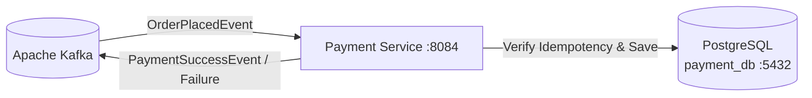

# 💳 Payment Service — ChaloKharido Microservices Platform

[](https://www.oracle.com/java/)
[](https://spring.io/projects/spring-boot)
[](https://www.postgresql.org/)
[](https://kafka.apache.org/)
[](https://www.docker.com/)

Payment processing microservice with **Idempotent Transaction Handling** for the **ChaloKharido** e-commerce platform. Built with **Spring Boot 3**, **PostgreSQL** (`payment_db`), and **Apache Kafka** executing the payment phase of the **Choreography Saga** on port `8084`.

---

## 🌟 Key Features

- **🛡️ Idempotent Payment Processing**: Prevents double-charging by verifying duplicate transaction IDs before execution.
- **⚡ Event-Driven Saga Step**:
  - Consumes `OrderPlacedEvent` asynchronously from Apache Kafka.
  - Verifies payment, records transaction in `payment_db`, and publishes `PaymentSuccessEvent` or `PaymentFailureEvent`.
- **📦 Database-per-Service**: Independent `payment_db` schema in PostgreSQL ensuring high data isolation and financial compliance.
- **🐳 Containerized**: Dockerized for instant deployment.

---

## 🏗️ Architecture



---

## ⚙️ Configuration

Configured via `application.properties`:

```properties
spring.application.name=payment-service
server.port=8084

spring.datasource.url=jdbc:postgresql://localhost:5432/payment_db
spring.datasource.username=postgres
spring.datasource.password=postgres

spring.kafka.bootstrap-servers=localhost:9092
spring.kafka.consumer.group-id=payment-group
```

---

## 🚀 Running Locally

```bash
# Run with Maven Wrapper
./mvnw clean spring-boot:run
```
*(On Windows: `mvnw.cmd spring-boot:run`)*

---

## 🐳 Docker Deployment

```bash
# Package JAR
./mvnw clean package -DskipTests

# Build Docker Image
docker build -t payment-service:latest .

# Run Container
docker run -d -p 8084:8084 --name payment-service payment-service:latest
```

---

## 👤 Author
* **Suzain Naaz**
* GitHub: [@suzain2024](https://github.com/suzain2024)
